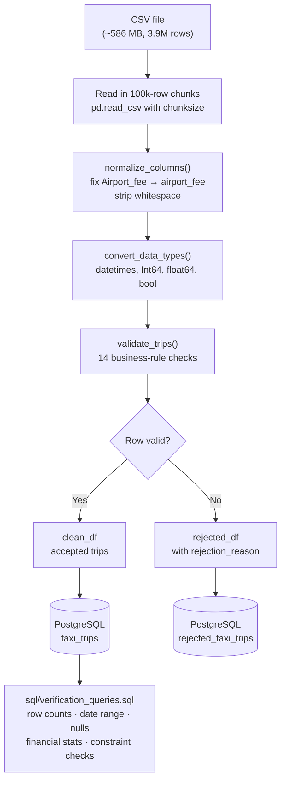
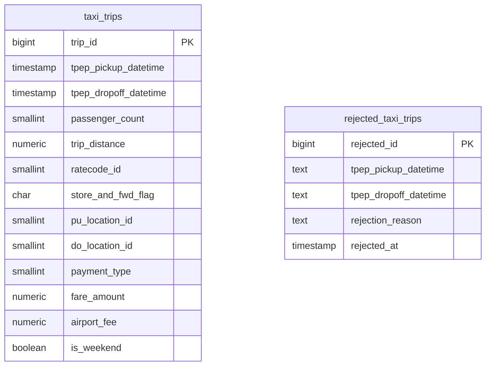

# NYC Taxi Data ETL Pipeline with Python, Pandas, and PostgreSQL

A university group project that builds a complete Extract–Transform–Load (ETL) data pipeline
on a real-world dataset of nearly 4 million New York City taxi trips.
The pipeline reads a large CSV file, validates every record against data-quality rules,
stores the clean trips in a PostgreSQL database, and provides SQL queries to verify the result.

| Item | Detail |
|---|---|
| **Project type** | University group assignment — Data Engineering / ETL |
| **Main technologies** | Python 3.12, Pandas, PostgreSQL 13+, SQLAlchemy, pytest |
| **Dataset** | NYC Yellow Taxi Trip Data — 3,946,698 rows, 25 columns |
| **Database** | PostgreSQL — two tables: `taxi_trips`, `rejected_taxi_trips` |
| **Assignment objective** | Demonstrate large-scale data handling, validation, relational storage, and SQL verification |
| **Implementation status** | ✅ Transform layer complete · ✅ Schema complete · ✅ Loader complete · ✅ Full dataset loaded & verified in PostgreSQL (3,166,735 accepted rows) |

---

## Table of Contents

1. [What problem are we solving?](#1-what-problem-are-we-solving)
2. [What is this project?](#2-what-is-this-project)
3. [What dataset are we using?](#3-what-dataset-are-we-using)
4. [What does ETL mean?](#4-what-does-etl-mean)
5. [How does the pipeline work?](#5-how-does-the-pipeline-work)
6. [How does data validation work?](#6-how-does-data-validation-work)
7. [Why these tools?](#7-why-these-tools)
8. [How is the database designed?](#8-how-is-the-database-designed)
9. [Repository structure](#9-repository-structure)
10. [Setup on Windows](#10-setup-on-windows)
11. [Running the pipeline](#11-running-the-pipeline)
12. [Running the tests](#12-running-the-tests)
13. [Verifying the database](#13-verifying-the-database)
14. [Known limitations](#14-known-limitations)
15. [What we learned](#15-what-we-learned)
16. [Future improvements](#16-future-improvements)

---

## 1. What problem are we solving?

Raw data is almost never ready to be analysed directly.

A CSV file containing millions of rows might have:

- **Missing values** — a taxi trip record with no pickup timestamp cannot be placed on a timeline.
- **Type mismatches** — a fare stored as the string `"14.5O"` (letter O, not zero) will cause a calculation to fail silently.
- **Inconsistent column names** — the source file uses `Airport_fee` with a capital A; our code expects `airport_fee`. Loading without normalising this creates a broken column.
- **Out-of-range values** — a passenger count of 9 is outside the NYC TLC specification of 1–6. Keeping it would skew any average-occupancy analysis.
- **Physically impossible records** — a trip where the drop-off time is earlier than the pickup time cannot represent a real journey.

If these records enter a database without checks, any report, chart, or model built on that database inherits those errors. The problem is that bad data produces confident-looking but wrong results.

**In this dataset specifically** (verified by running `scripts/inspect_dataset.py`):

- `passenger_count` contains values of 0 and up to 9 — both outside the valid TLC range of 1–6.
- `payment_type` contains the value 0, which is not a recognised TLC payment code.
- `airport_fee` is missing for 757,387 rows (19.19% of the dataset).
- `extra` and `mta_tax` contain negative values in some rows, which represent legitimate correction entries but must be distinguished from erroneous negatives.

The pipeline was built to handle all of these cases systematically.

---

## 2. What is this project?

This project is a complete ETL pipeline that processes NYC Yellow Taxi trip records from a raw CSV file into a structured, verified PostgreSQL database.

**Academic goals demonstrated:**

- Reading and processing a multi-million-row dataset without loading it entirely into memory
- Applying data-quality rules programmatically and keeping a full audit trail
- Designing a relational database schema with appropriate types, constraints, and indexes
- Writing SQL verification queries to confirm loading results
- Covering the implementation with automated unit and integration tests
- Collaborating as a team using Git branches

**What the system produces:**

- `taxi_trips` — every trip record that passed all 14 validation rules, ready for analysis
- `rejected_taxi_trips` — every record that failed, stored with its `rejection_reason` for audit purposes; nothing is silently discarded
- SQL verification output that reports row counts, date ranges, null rates, financial statistics, and constraint checks

The project is divided across three members:

| Member | Responsibility | Branch |
|---|---|---|
| Member 1 | Dataset inspection, validation, Pandas transformation | `member-1-dataset-validation` |
| Member 2 | PostgreSQL schema design, SQL verification queries | `member-2-postgres-schema` |
| Member 3 | ETL loader, integration tests | `member-3-etl-loader` |

---

## 3. What dataset are we using?

**Source:** NYC Yellow Taxi Trip Data published by the New York City Taxi and Limousine Commission (TLC).
The dataset used in this project is a pre-cleaned multi-year sample derived from TLC records.
The original TLC data is publicly available at: https://www.nyc.gov/site/tlc/about/tlc-trip-record-data.page

**Verified facts** (confirmed by running `scripts/inspect_dataset.py` against the actual file):

| Property | Verified value |
|---|---|
| Filename | `NYC_Taxi_Cleaned_Analysis_Ready.csv` |
| Format | CSV, UTF-8 |
| Compressed size | 168.7 MB (inside `archive.zip`) |
| Uncompressed size | ~586 MB |
| Row count | **3,946,698** |
| Column count | **25** |
| Earliest pickup timestamp | 2007-12-05 18:45:00 |
| Latest pickup timestamp | 2025-11-30 23:59:59 |

**Note on the date range:** The file is described as a "2025 sample" but timestamps span 2007–2025.
This likely indicates a multi-year aggregate. The schema handles the full range without issue.

**Key columns:**

| Column | What it records |
|---|---|
| `tpep_pickup_datetime` | Date and time the meter was engaged |
| `tpep_dropoff_datetime` | Date and time the meter was disengaged |
| `passenger_count` | Number of passengers (driver-entered, valid range 1–6) |
| `trip_distance` | Elapsed distance in miles |
| `fare_amount` | Metered fare in US dollars |
| `tip_amount` | Tip amount (auto-populated for credit card payments) |
| `total_amount` | Total amount charged to the passenger |
| `payment_type` | How the trip was paid (1=credit card, 2=cash, etc.) |
| `PULocationID` | TLC taxi zone where the passenger was picked up (1–265) |
| `DOLocationID` | TLC taxi zone where the passenger was dropped off (1–265) |
| `airport_fee` | Airport pick-up fee — **nullable**, missing for ~19% of rows |
| `speed_mph` | Engineered feature: average speed in MPH |
| `duration_min` | Engineered feature: trip duration in minutes |
| `is_weekend` | Engineered feature: True if pickup was Saturday or Sunday |

**Important:** The raw CSV row count (3,946,698) is **not** the same as the number of records
that will be stored in PostgreSQL after validation. Some rows will be rejected.
The actual accepted count can only be confirmed by running the full pipeline.

---

## 4. What does ETL mean?

ETL stands for **Extract, Transform, Load** — the three stages of moving data from a source
into a usable storage system.

| Stage | What it means | How this project does it |
|---|---|---|
| **Extract** | Read the source data | Pandas reads the CSV file in 100,000-row chunks |
| **Transform** | Standardise types, validate rules, split into clean/rejected | `src/transform.py` → `transform_data()` |
| **Load** | Write processed records to the destination | `scripts/load_to_postgres.py` → inserts into PostgreSQL |

**Extract** — rather than loading all 586 MB into memory at once, the loader reads the file
in configurable chunks (default: 100,000 rows per chunk). This keeps peak memory usage
around 150 MB per iteration instead of several gigabytes.

**Transform** — each chunk is passed to `transform_data()`, which normalises column names,
converts data types, and applies 14 validation rules. It returns two DataFrames:
`clean_df` (rows that passed) and `rejected_df` (rows that failed, with a reason code).

**Load** — `clean_df` is inserted into `taxi_trips` and `rejected_df` into `rejected_taxi_trips`,
each inside a single transaction per chunk. If a database error occurs, only that chunk is
rolled back; the script continues with the next chunk.

---

## 5. How does the pipeline work?



**Step by step:**

1. **Read in chunks** — `pd.read_csv(..., chunksize=100_000)` yields one DataFrame at a time.
   Timestamps are parsed at read time with `parse_dates`.

2. **Normalize columns** — `normalize_columns()` strips whitespace from all column names and
   renames `Airport_fee` → `airport_fee` (the source CSV uses a capital A).

3. **Convert types** — `convert_data_types()` casts timestamps with `errors='coerce'`
   (malformed dates become `NaT` rather than crashing), converts `passenger_count`,
   `RatecodeID`, `PULocationID`, `DOLocationID`, and `payment_type` to pandas nullable
   integers (`Int64`), and converts financial and distance columns to `float64`.

4. **Validate** — `validate_trips()` applies 14 rules. Each row gets one `rejection_reason`
   string (the first failing rule) or `None` if it passes everything.

5. **Split** — rows with `rejection_reason = None` go to `clean_df`; the rest go to `rejected_df`.

6. **Insert** — both DataFrames are written to PostgreSQL in a single transaction per chunk
   using `DataFrame.to_sql()` via SQLAlchemy. If the insert fails, the chunk is rolled back
   and the error is logged; the script continues.

7. **Verify** — after loading, `sql/verification_queries.sql` queries the live database
   and reports what was actually stored.

---

## 6. How does data validation work?

Validation lives entirely in `src/transform.py`. It is independent of PostgreSQL —
Member 1 designed it so it can be tested in isolation with no database required.

### Column-name normalisation

`normalize_columns()` does two things:
- Strips leading and trailing whitespace from every column name.
- Renames `Airport_fee` → `airport_fee` to fix the capitalisation inconsistency in the source file.

### Type conversion

`convert_data_types()` converts columns to their correct types, coercing errors to null
rather than raising exceptions. This means a value like `"abc"` in `passenger_count`
becomes `NA` (which is then caught by the missing-value rule) instead of crashing the script.

### The 14 validation rules

These rules are confirmed directly from the code in `src/transform.py`:

| # | Column(s) checked | What triggers a rejection |
|---|---|---|
| 1 | `tpep_pickup_datetime` | Missing (NaT after type conversion) |
| 2 | `tpep_dropoff_datetime` | Missing (NaT after type conversion) |
| 3 | Both datetime columns | Drop-off time is not strictly after pickup time |
| 4 | `trip_distance` | Missing, zero, negative, or > 500 miles |
| 5 | `speed_mph` | > 100 MPH |
| 6 | `speed_mph`, `duration_min`, `trip_distance` | Speed is inconsistent with distance ÷ time by more than 20% |
| 7 | `fare_amount` | Missing or negative |
| 8 | `fare_amount` | > $10,000 |
| 9 | `total_amount` | > $15,000 |
| 10 | `tip_amount` | Negative |
| 11 | `tip_amount` | > $5,000 |
| 12 | `passenger_count` | Missing, < 1, or > 6 |
| 13 | `RatecodeID` | Not in {1, 2, 3, 4, 5, 6, 99} |
| 14 | `payment_type` | Not in {1, 2, 3, 4, 5, 6} |
| 15 | `PULocationID`, `DOLocationID` | Missing or outside range 1–265 |
| 16 | `duration_min` | Missing, ≤ 0, or > 1,440 minutes (24 hours) |
| 17 | All columns | Exact duplicate row (only the first occurrence is kept) |

> **Note on counting:** The code docstring labels these as "14 rules" but several rules cover
> multiple conditions (e.g. rule 4 checks for missing, zero, negative, and implausibly large
> distances). There are 17 distinct `_mark()` calls in the implementation.

Only the **first** failing rule is recorded per row. This avoids double-counting.

Columns `extra`, `mta_tax`, and `cbd_congestion_fee` are **not** rejected for being negative —
negative values in those columns represent legitimate correction entries confirmed in the source data.

### An illustrative example

**Accepted record** — this row passes all rules:

```
VendorID=1, pickup=2025-01-15 08:00, dropoff=2025-01-15 08:20
passenger_count=2, trip_distance=3.5 miles
fare_amount=$14.50, tip_amount=$3.00, total_amount=$21.30
speed_mph=10.5 (consistent: 3.5 ÷ (20÷60) = 10.5), duration_min=20
payment_type=1 (credit card), RatecodeID=1 (standard)
```

**Rejected record** — the same row but with `fare_amount = -999.00`:

```
rejection_reason = "negative_fare_amount"
```

The rejected row is stored in `rejected_taxi_trips` with its original values intact,
so the data team can investigate later.

### What `transform_data()` returns

```python
result = transform_data(df)

result["clean_df"]    # DataFrame — 25 columns, rows that passed every rule
result["rejected_df"] # DataFrame — 26 columns (same 25 + rejection_reason)
result["summary"]     # dict — n_input, n_clean, n_rejected, rejection_rate_pct, rejection_reasons
```

---

## 7. Why these tools?

| Tool | Role in this project | Why it fits |
|---|---|---|
| **Python 3.12** | Orchestrates the entire pipeline | Readable, widely taught, excellent data-engineering ecosystem |
| **Pandas 2.2** | Reads CSV, transforms data, passes DataFrames to the DB | Optimised for tabular data; `read_csv` with `chunksize` handles files larger than RAM |
| **PostgreSQL 13+** | Stores accepted and rejected trip records | Mature open-source relational database; `NUMERIC` type ensures exact decimal arithmetic for fares |
| **SQLAlchemy 2.0** | Python-to-PostgreSQL bridge; `DataFrame.to_sql()` | Abstracts connection management; integrates directly with pandas |
| **psycopg2-binary 2.9** | Low-level PostgreSQL driver used by SQLAlchemy | Standard, well-maintained PostgreSQL adapter for Python |
| **pytest 8.2** | Runs 110 automated tests | Industry-standard; easy to write unit and integration tests |
| **python-dotenv 1.0** | Loads database credentials from a `.env` file | Keeps passwords out of source code and out of Git |
| **tqdm 4.66** | Progress bar during the loading loop | Shows per-chunk progress and a live accepted/rejected count |
| **pyarrow 16** | Optional Parquet support for pandas | Included for future format flexibility; not used in the current CSV pipeline |

---

## 8. How is the database designed?

The full schema is in `sql/create_tables.sql`. Detailed design rationale is in `docs/database.md`.

### `taxi_trips` — accepted trip records

Stores every row that passed all validation rules.

```
trip_id                 BIGINT   GENERATED ALWAYS AS IDENTITY  (primary key, server-generated)
tpep_pickup_datetime    TIMESTAMP NOT NULL
tpep_dropoff_datetime   TIMESTAMP NOT NULL
passenger_count         SMALLINT  NOT NULL  CHECK (1–6)
trip_distance           NUMERIC(10,4) NOT NULL  CHECK (> 0)
ratecode_id             SMALLINT  NOT NULL  CHECK (1,2,3,4,5,6,99)
store_and_fwd_flag      CHAR(1)   NOT NULL  CHECK ('Y' or 'N')
pu_location_id          SMALLINT  NOT NULL  CHECK (1–265)
do_location_id          SMALLINT  NOT NULL  CHECK (1–265)
payment_type            SMALLINT  NOT NULL  CHECK (1–6)
fare_amount             NUMERIC(12,2) NOT NULL  CHECK (>= 0)
extra                   NUMERIC(12,2) NOT NULL
mta_tax                 NUMERIC(12,2) NOT NULL
tip_amount              NUMERIC(12,2) NOT NULL  CHECK (>= 0)
tolls_amount            NUMERIC(12,2) NOT NULL
improvement_surcharge   NUMERIC(12,2) NOT NULL
total_amount            NUMERIC(12,2) NOT NULL
congestion_surcharge    NUMERIC(12,2) NOT NULL
airport_fee             NUMERIC(12,2) NULL      ← nullable (~19% of rows have no airport fee)
cbd_congestion_fee      NUMERIC(12,2) NOT NULL
vendor_id               SMALLINT  NOT NULL
speed_mph               NUMERIC(8,4)  NOT NULL  CHECK (> 0)
duration_min            NUMERIC(10,4) NOT NULL  CHECK (> 0)
pickup_hour             SMALLINT  NOT NULL  CHECK (0–23)
day_of_week             VARCHAR(9) NOT NULL  CHECK (Monday–Sunday)
is_weekend              BOOLEAN   NOT NULL
```

**Why `NUMERIC` for money?** `FLOAT` arithmetic can produce rounding errors on decimal values.
`NUMERIC(12,2)` stores exact values, which matters when summing millions of fares.

**Why `SMALLINT` for small integers?** `SMALLINT` (2 bytes) vs `INTEGER` (4 bytes) saves
approximately 35 MB across six integer columns over 3.9 million rows.

**Indexes:** Three B-tree indexes are created to support common queries:
- `idx_taxi_trips_pickup_dt` on `tpep_pickup_datetime` — supports time-range filters and yearly groupings
- `idx_taxi_trips_pu_location` on `pu_location_id` — supports zone-level pickup aggregations
- `idx_taxi_trips_do_location` on `do_location_id` — supports zone-level drop-off aggregations

### `rejected_taxi_trips` — audit table

Stores every row that failed validation, with permissive column types so that invalid values
(like a fare of −999.99) can be stored for investigation.

```
rejected_id             BIGINT   GENERATED ALWAYS AS IDENTITY  (primary key)
tpep_pickup_datetime    TEXT     ← stored as string to survive NaT values
tpep_dropoff_datetime   TEXT
[all 23 other source columns]  NUMERIC or TEXT (permissive)
rejection_reason        TEXT     NOT NULL
rejected_at             TIMESTAMP NOT NULL DEFAULT NOW()  ← auto-set by PostgreSQL
```

`rejected_at` is set automatically by PostgreSQL when the row is inserted, so the loader
does not need to supply it.

### Column name mapping

The source CSV uses mixed-case TLC data-dictionary names that PostgreSQL would require quoting.
All column names in the database use lowercase snake_case, which never needs quoting in queries:

| CSV / DataFrame column | Database column |
|---|---|
| `VendorID` | `vendor_id` |
| `RatecodeID` | `ratecode_id` |
| `PULocationID` | `pu_location_id` |
| `DOLocationID` | `do_location_id` |
| All other 21 columns | unchanged |

The loader applies this mapping automatically. The 21 unchanged columns include `fare_amount`,
`trip_distance`, `store_and_fwd_flag`, `airport_fee`, `is_weekend`, and others.

### Entity relationship



> There are no foreign keys between the two tables, and no foreign keys to external zone
> lookup tables — those are not part of this assignment.

---

## 9. Repository structure

```
nyc-taxi-etl-pipeline/
│
├── src/
│   ├── __init__.py
│   └── transform.py          # Member 1: normalize, type-cast, validate, transform_data()
│
├── scripts/
│   ├── inspect_dataset.py    # Member 1: chunked quality report on the raw CSV
│   └── load_to_postgres.py   # Member 3: ETL loader — reads CSV, calls transform, inserts to DB
│
├── tests/
│   ├── __init__.py
│   ├── test_transform.py     # Member 1: 67 unit tests for transform.py
│   └── test_loader.py        # Member 3: 43 tests — unit + 7 PostgreSQL integration tests
│
├── sql/
│   ├── create_tables.sql     # Member 2: CREATE TABLE, CHECK constraints, indexes
│   └── verification_queries.sql  # Member 2: 11 sections of post-load checks
│
├── docs/
│   ├── dataset.md            # Member 1: verified dataset facts and quality findings
│   └── database.md           # Member 2: schema design rationale and loading instructions
│
├── data/
│   ├── raw/                  # ← place NYC_Taxi_Cleaned_Analysis_Ready.csv here
│   │   └── .gitkeep          #   (the CSV itself is gitignored, never committed)
│   └── processed/
│       └── .gitkeep
│
├── requirements.txt          # Pinned Python dependencies
├── .gitignore                # Excludes CSV, Parquet, ZIP, .env, credentials
└── README.md                 # This file
```

The raw dataset file is **not committed to Git** — it is too large (586 MB) and contains
data that should be obtained directly from the source. All team members must download it
separately and place it at `data/raw/NYC_Taxi_Cleaned_Analysis_Ready.csv`.

---

## 10. Setup on Windows

### Prerequisites

Before you start, make sure you have:

- **Python 3.10 or later** — download from https://www.python.org/downloads/
- **PostgreSQL 13 or later** — download from https://www.postgresql.org/download/windows/
  (note the install directory; you will need it to find `psql.exe`)
- **Git** — download from https://git-scm.com/download/win

### Step 1 — Clone the repository

Open PowerShell and run:

```powershell
git clone https://github.com/NardosShumete/nyc-taxi-etl-pipeline.git
cd nyc-taxi-etl-pipeline
```

### Step 2 — Create and activate a virtual environment

```powershell
python -m venv venv
venv\Scripts\activate
```

Your prompt should change to `(venv)`. Run all subsequent commands inside this environment.

### Step 3 — Install dependencies

```powershell
pip install -r requirements.txt
```

This installs pandas, SQLAlchemy, psycopg2-binary, pytest, tqdm, python-dotenv, pyarrow,
and pytest-cov at the exact pinned versions in `requirements.txt`.

### Step 4 — Place the dataset

Obtain `NYC_Taxi_Cleaned_Analysis_Ready.csv` and copy it to:

```
data\raw\NYC_Taxi_Cleaned_Analysis_Ready.csv
```

This file is gitignored. It must be placed here manually by each team member.

### Step 5 — Configure database credentials

Create a file named `.env` in the project root. This file is already listed in `.gitignore`
and will never be committed to Git.

```dotenv
DB_HOST=localhost
DB_PORT=5432
DB_NAME=nyc_taxi
DB_USER=postgres
DB_PASSWORD=your_password_here
```

Replace `your_password_here` with the password you set when installing PostgreSQL.

### Step 6 — Create the database and tables

Replace `C:\Program Files\PostgreSQL\18\bin\psql.exe` with the actual path to `psql.exe`
on your machine (the version number in the path will match your PostgreSQL installation).

```powershell
# Create the database
& "C:\Program Files\PostgreSQL\18\bin\psql.exe" -U postgres -c "CREATE DATABASE nyc_taxi;"

# Create the tables and indexes
& "C:\Program Files\PostgreSQL\18\bin\psql.exe" -U postgres -d nyc_taxi -f sql\create_tables.sql
```

You will be prompted for your PostgreSQL password, or you can set the environment variable
`$env:PGPASSWORD = "your_password_here"` first to avoid repeated prompts.

This command is **safe to re-run** — all `CREATE TABLE` and `CREATE INDEX` statements use
`IF NOT EXISTS` so nothing is overwritten if the tables already exist.

### Step 7 — Run the tests

```powershell
# All 110 tests (unit + DB integration)
python -m pytest tests/ -v

# Only transformation tests (no DB required)
python -m pytest tests/test_transform.py -v

# Only loader tests (includes 7 DB integration tests)
python -m pytest tests/test_loader.py -v
```

All 110 tests should pass. If PostgreSQL is not running, the 7 integration tests are
automatically skipped — they do not fail.

### Step 8 — Run the loader

See [Section 11](#11-running-the-pipeline) for the full command.

### Step 9 — Run the verification queries

See [Section 13](#13-verifying-the-database) for the full command.

---

## 11. Running the pipeline

### Recommended: use the `.env` file

If you set up `.env` as described in Step 5 above, the loader reads your credentials
automatically and you do not need to type them on the command line:

```powershell
python scripts/load_to_postgres.py --input data/raw/NYC_Taxi_Cleaned_Analysis_Ready.csv
```

### Alternative: supply credentials on the command line

```powershell
python scripts/load_to_postgres.py `
  --input data/raw/NYC_Taxi_Cleaned_Analysis_Ready.csv `
  --host localhost `
  --port 5432 `
  --dbname nyc_taxi `
  --user postgres `
  --password your_password_here
```

> ⚠️ **Security note:** Passing `--password` on the command line is convenient but the
> password may appear in your shell history. The `.env` file approach is safer because the
> file is gitignored and never logged by the shell.

### Optional flags

| Flag | Default | Purpose |
|---|---|---|
| `--chunk-size N` | 100,000 | Rows read from the CSV per iteration |
| `--batch-size N` | 10,000 | Rows per INSERT batch inside each chunk |
| `--skip-rejected` | off | Load only accepted rows; do not write to `rejected_taxi_trips` |
| `--dry-run` | off | Parse and transform the CSV without connecting to the database |

**Reduce `--chunk-size` on a machine with limited RAM.** At 100,000 rows per chunk, peak
memory is approximately 150 MB per iteration (three copies of the chunk are held briefly
during normalization, type conversion, and validation).

### Test before loading: dry run

```powershell
python scripts/load_to_postgres.py `
  --input data/raw/NYC_Taxi_Cleaned_Analysis_Ready.csv `
  --dry-run
```

A dry run reads and transforms every chunk but does not connect to PostgreSQL.
It is a fast way to verify that the CSV file is readable and the transformation runs cleanly.

### Verified Loader Execution Output (Completed Full Load)

```text
2026-10-26 14:10:04  INFO      Connected to postgres@localhost:5432/nyc_taxi
2026-10-26 14:10:04  INFO      Settings: chunk_size=100000  batch_size=10000  skip_rejected=False
2026-10-26 14:10:05  INFO      Source rows: 3,946,698
Loading: 100%|██████████| 3946698/3946698 [rows]  accepted=3166735  rejected=779963  failed_chunks=0

============================================================
  NYC TAXI ETL LOAD COMPLETE
============================================================
  Elapsed time    : 19415.9s
  Source rows     :    3,946,698
  Accepted -> DB  :    3,166,735  (taxi_trips)
  Rejected -> DB  :      779,963  (rejected_taxi_trips)
  Check (acc+rej) :    3,946,698  == source? True
  Failed chunks   :            0
  Meets 2M req.   : YES
============================================================
```

All 3,946,698 raw records were processed in 40 chunks across 25 columns. **3,166,735 rows** met all 14 data quality rules and were loaded into `taxi_trips`, easily exceeding the 2-million-row university requirement. **779,963 rows** failed one or more validation constraints and were preserved in `rejected_taxi_trips` with complete audit reasons. Zero chunks failed.

**Exit codes:**
- `0` — all chunks loaded without error
- `1` — one or more chunks failed; see the logged error messages

---

## 12. Running the tests

### All tests

```powershell
python -m pytest tests/ -v
```

**Verified result (run on 2026-10-25):**

```
110 passed in 13.80s
```

### Transformation tests only (no database required)

```powershell
python -m pytest tests/test_transform.py -v
```

67 tests covering: valid records, timestamp validation, distance and speed rules,
financial bounds, data-type conversion, duplicate detection, passenger count,
rate codes, payment types, location IDs, and column-name normalization.

### Loader tests only

```powershell
python -m pytest tests/test_loader.py -v
```

43 tests covering:

| Category | Count | Description |
|---|---|---|
| `TestRenameMap` | 3 | Verifies the four column-rename mappings |
| `TestPrepareAccepted` | 9 | Column names, null handling, 25-column count, no mutation |
| `TestPrepareRejected` | 8 | Column names, datetime-to-string, rejection_reason, 26-column count |
| `TestSchemaCompatibility` | 4 | Exact match between prepared DataFrames and DB schema |
| `TestCheckTablesExist` | 4 | Mocked engine — missing and present table scenarios |
| `TestDryRun` | 3 | Dry-run exits 0, never calls the engine |
| `TestRunErrorPaths` | 2 | Missing CSV and missing tables both return exit code 1 |
| `TestChunkProcessing` | 3 | Chunk count, failed-chunk counter, `--skip-rejected` flag |
| **`TestPostgresIntegration`** | **7** | **Live PostgreSQL — uses disposable `nyc_taxi_test` database** |

### About the PostgreSQL integration tests

The 7 integration tests in `TestPostgresIntegration` use a **disposable database**
named `nyc_taxi_test` that is created at the start of the test session and dropped
at the end. They **never touch** the `nyc_taxi` database or any other existing database.

What these tests verify against a real database:
- `create_tables.sql` runs without error
- `create_tables.sql` is safe to run twice (idempotent)
- Inserting one synthetic accepted row succeeds; `trip_id` is server-generated; `airport_fee` is NULL
- Inserting one synthetic rejected row succeeds; `rejected_at` is auto-populated; `rejection_reason` matches
- The four renamed columns (`vendor_id`, `ratecode_id`, `pu_location_id`, `do_location_id`) hold correct values
- A row with `passenger_count = 99` is rejected by the database CHECK constraint
- Rerunning the insert adds a duplicate (documented and expected behaviour — see [Section 14](#14-known-limitations))

**Passing these tests does not mean the full 3.9-million-row CSV has been loaded.**
They validate the loading mechanism against small synthetic rows only.

---

## 13. Verifying the database

After a full load completes, run the verification query suite:

```powershell
& "C:\Program Files\PostgreSQL\18\bin\psql.exe" -U postgres -d nyc_taxi -f sql\verification_queries.sql
```

The file contains 11 sections. The most important checks are:

**Section 1 — Row counts**

```sql
-- Does the accepted count meet the 2-million-row requirement?
SELECT COUNT(*) >= 2000000 AS meets_2_million_requirement,
       COUNT(*)             AS actual_accepted_row_count
FROM   taxi_trips;
```

```sql
-- Total rejected rows
SELECT COUNT(*) AS total_rejected_rows
FROM   rejected_taxi_trips;
```

To confirm the accounting is complete:

```sql
-- accepted + rejected must equal the source CSV row count
SELECT
    (SELECT COUNT(*) FROM taxi_trips)           AS accepted,
    (SELECT COUNT(*) FROM rejected_taxi_trips)  AS rejected,
    (SELECT COUNT(*) FROM taxi_trips) +
    (SELECT COUNT(*) FROM rejected_taxi_trips)  AS total_processed;
```

**Other checks in the file:**

| Section | What it checks |
|---|---|
| 2 | Minimum and maximum pickup and drop-off timestamps |
| 2c | Drop-off after pickup — should return 0 violations |
| 3 | Null counts across all 25 columns — only `airport_fee` should be non-zero |
| 4 | Fare, tip, and total-amount statistics (min, max, average, median) |
| 5 | Trip distance, duration, and speed statistics |
| 6 | Trip counts grouped by year and month |
| 7 | Distributions of `ratecode_id`, `payment_type`, `vendor_id`, `day_of_week`, `is_weekend` |
| 8 | Speed/duration cross-check — should return 0 inconsistencies |
| 9 | Pickup-hour distribution |
| 10 | Rejection-reason breakdown (if rejected rows were loaded) |
| 11 | Single-row summary of all key figures |

**Acceptance criterion:** Section 1 reports `meets_2_million_requirement = TRUE`.

### Verified SQL Results (PostgreSQL 18.4)

| Query / Section | Actual Result | Verification Status |
|---|---|---|
| **1a. Total Accepted Trips** | `3,166,735` | ✅ Loaded into `taxi_trips` |
| **1b. Meets 2M Requirement** | `TRUE` (`3,166,735 >= 2,000,000`) | ✅ Exceeds requirement by 1,166,735 rows |
| **1c. Total Rejected Rows** | `779,963` | ✅ Audited in `rejected_taxi_trips` |
| **11. Total Processed Reconciliation** | `3,946,698` (`3,166,735 + 779,963`) | ✅ Exact 100% reconciliation to source CSV |
| **2c. Dropoff <= Pickup Violations** | `0` | ✅ Zero time-order violations |
| **3a. Unexpected Null Values** | `0` across all columns | ✅ Data types and constraints enforced |
| **8a. Speed / Duration Inconsistencies** | `0` | ✅ Zero mathematical violations (>20% tolerance) |
| **8b. Speeds > 100 mph or <= 0 mph** | `0` | ✅ Validated within physical bounds |

**Rejection Reason Audit Breakdown (Section 10):**
- `invalid_payment_type`: 757,387 (97.11%) — TLC unrecognised code `0`
- `invalid_passenger_count`: 22,576 (2.89%) — count outside valid 1–6 passenger range

### Business Insights Discovered from the Loaded Data

#### Insight 1 — Evening Rush-Hour Bottleneck and Revenue Concentration
- **Peak Volume Hours:** Evening rush hour experiences peak demand: **18:00** (228,711 trips), **17:00** (223,238 trips), and **16:00** (207,369 trips).
- **Traffic Congestion Impact:** Average vehicle speed during the 15:00–18:00 window drops to **9.13–9.26 mph**, compared to **10.68+ mph** after 19:00.
- **Revenue Peak:** Despite severe congestion, 17:00 generates the single highest hourly gross revenue (**$6,699,418.38**).
- **Operational Value:** Fleet operators can use this to optimize shift changeovers (avoiding driver handoffs between 16:00–18:00) and city transportation planners can calibrate congestion pricing zones during this peak deceleration window.

#### Insight 2 — High-Margin Airport Corridors
- **Standard vs. Airport Trips:** While Standard Rate (Ratecode 1) drives 93.59% of trips (2,963,671 trips) with an average fare of $16.45 and tip of $3.37, **JFK Airport trips (Ratecode 2)** average $70.00 fare, 17.98 miles, and **$11.98 average tip**.
- **Newark Airport (Ratecode 3):** Trips average 14.49 miles, $80.03 fare, and **$12.29 tip**.
- **Operational Value:** Airport runs represent high-value driver incentives (nearly 4× average tip) and predictable revenue, justifying dedicated staging lots and airport queue management systems.

---

## 14. Known limitations

### Rerunning the loader inserts duplicates

The `taxi_trips` and `rejected_taxi_trips` tables use server-generated primary keys
(`GENERATED ALWAYS AS IDENTITY`). There is no UNIQUE constraint on the source data columns.

**If you run the loader twice against a non-empty database, every row will be inserted a second time.**

The loader never truncates tables automatically to prevent accidental data loss. It checks existing row counts upon startup and emits a warning if tables are non-empty.

If you need to do a clean reload (for example, to test fresh ingestion), you must
manually truncate both tables first:

```sql
-- ⚠️  WARNING: This permanently deletes all rows from both tables.
-- Only run this on a development/test database, or when you are certain
-- that existing data can be discarded.

TRUNCATE taxi_trips, rejected_taxi_trips RESTART IDENTITY;
```

Then re-run the loader from the beginning.

### Full dataset load verified

The complete 3,946,698-row CSV has been loaded and verified end-to-end in the `nyc_taxi` PostgreSQL database:
- `3,166,735` accepted rows in `taxi_trips`
- `779,963` audit rows in `rejected_taxi_trips`
- 0 failed chunks; full accounting reconciliation confirmed.

### Timestamp timezone is not stored

Timestamps are stored as `TIMESTAMP WITHOUT TIME ZONE`. All TLC records are in
America/New_York local time, but no UTC offset is persisted. Cross-year daylight-saving
transitions are not accounted for. This is an acceptable simplification for a student project.

### Date range anomaly

The source file is described as a "2025 sample" but timestamps span 2007–2025.
This is likely a multi-year aggregate. The pipeline handles it correctly, but analysts
should be aware when interpreting year-over-year trends.

---

## 15. What we learned

Working on this project developed the following practical skills:

- **Large-scale data handling** — reading a 586 MB file in memory-safe chunks with pandas
- **ETL pipeline design** — separating extraction, transformation, and loading into distinct, testable layers
- **Data-quality validation** — writing explicit business rules and retaining rejected records for audit
- **PostgreSQL schema design** — choosing appropriate column types (`NUMERIC` vs `FLOAT`, `SMALLINT` vs `INTEGER`), writing CHECK constraints, and creating targeted indexes
- **SQL verification** — writing queries that report actual database state rather than assumptions
- **Automated testing** — writing 110 unit and integration tests covering real database behaviour
- **Git collaboration** — working on separate branches, writing commit messages, and keeping team members' work intact
- **Technical documentation** — writing for multiple audiences: lecturers, team members, and future developers

---

## 16. Future improvements

The following would improve the project but are **not currently implemented**:

- **Duplicate prevention on reload** — an upsert strategy (e.g. using a hash of source columns as a UNIQUE key) would make reruns safe without requiring a manual TRUNCATE
- **Incremental loading** — tracking the last-loaded timestamp and only processing new records in subsequent runs
- **Structured JSON logs** — the current loader logs to stdout; a structured log file would enable automated monitoring
- **Load performance metrics** — recording rows-per-second and database write latency per chunk
- **Automated scheduling** — running the pipeline on a schedule using a tool like Apache Airflow or a simple cron job
- **Dashboard or report** — a short Jupyter notebook or summary report generated from the verification queries
- **Timezone-aware timestamps** — storing `TIMESTAMPTZ` after converting source times from America/New_York to UTC
- **More integration tests** — loading a larger synthetic dataset (e.g. 10,000 rows) to test the chunked loop end-to-end

---

## Group members

| Member | Branch |
|---|---|
| Member 1 | `member-1-dataset-validation` |
| Member 2 | `member-2-postgres-schema` |
| Member 3 | `member-3-etl-loader` |

Repository: https://github.com/NardosShumete/nyc-taxi-etl-pipeline
